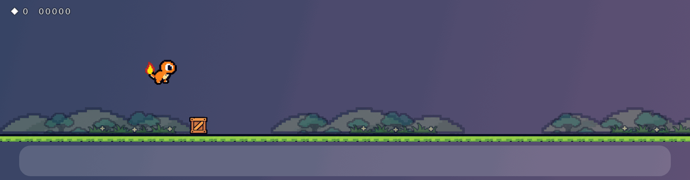
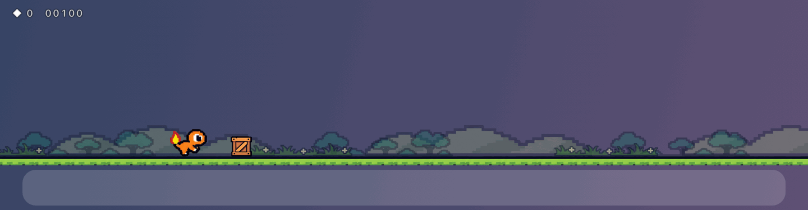
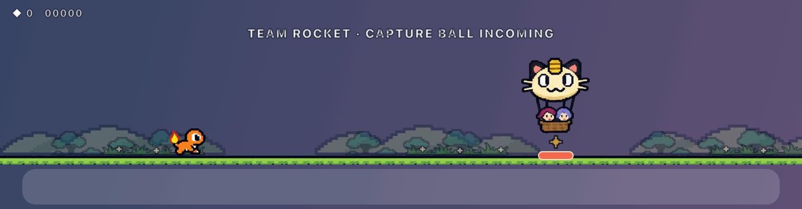
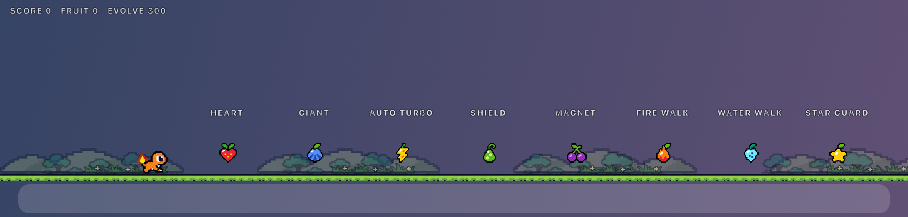
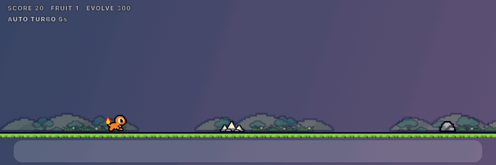
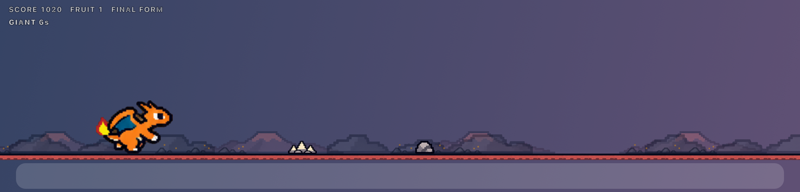
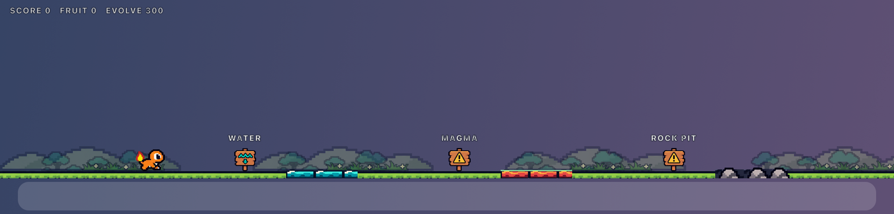
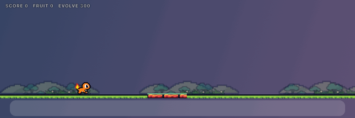
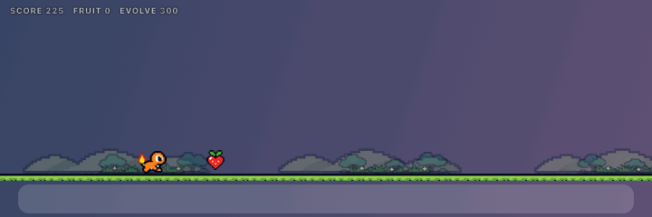

# Embertrail

A tiny endless runner that lives in a see-through strip just above your macOS Dock. Pick your starter (Charmander, Bulbasaur or Squirtle) and run across meadows, crystal caves and volcanoes. Jump rocks and triple spikes, cross elemental pits, collect occasional power fruits, dodge Team Rocket’s capture orbs, knock out its grunts, and watch your starter evolve twice along the way.


| Meadow | Crystal cave | Volcano |
|---|---|---|
|  |  |  |

## Choose your starter

Three Pokémon starters, each with three forms:

- **Charmander → Charmeleon → Charizard** (fire)
- **Bulbasaur → Ivysaur → Venusaur** (grass)
- **Squirtle → Wartortle → Blastoise** (water)

Pick one the first time you play. Switch anytime with **Change starter** on the home screen, or from the menu-bar menu ▸ Starter. Fire starters can walk across magma, water starters across water, and grass starters across rock pits. These type advantages stay with every evolution.


## Play

1. Click **▶ Play** on the strip (or the character icon in the menu bar ▸ **Play**). The strip takes keyboard focus only now, never on its own.
2. **Space** or **↑** to jump. Tap for a comfortable hop; hold for a higher, longer arc. Clicking and holding the strip works too. One press gives one jump, without automatic repeated bouncing.
3. **Esc** pauses and hands focus back to your other app. **P** pauses or resumes; **Enter** starts or restarts.

- **Hazards:** larger rocks, groups of three spikes, boulders, and later burrowing moles. Crabs do not spawn. Patterns are spaced 1.8–2.5 seconds apart early on, then at least 1.25 seconds apart, giving you time to land and prepare for the next jump.
- **Crates:** land on top safely, then press jump again to hop off. A press just before landing is buffered. Hitting the side pushes you backward and deducts up to 10 points once per crate; it does not end the run or make the score negative.

  
  

- **Elemental pits:** longer water, magma, and rock pits have labeled warning signs. Jump incompatible pits; walk across the one your type handles safely. A green line marks a safe surface. Pit widths grow from roughly 30–38 logical pixels to 40–48 as speed rises.
- **Fruit:** one pickup at a time, with at least 9 seconds between spawns (usually 9–14 seconds, longer during encounters or evolution). There are no collectible-ball streams. Heart, lightning, and dark blue introduce the powers, followed by random varieties. Team Rocket’s hostile capture balls remain hazards.
- **Score:** distance (1 point per 8 px), fruit points, and defeated-grunt bonuses, minus crate-hit penalties. Your best score is saved.
- **Evolution:** at **300 score** your starter takes its second form and enters the crystal cave; at **800 score** it takes its final form in the volcanic field. Distance and fruit bonuses both advance the displayed score. Evolution waits for safe ground and never skips a form.
- **Grunt ambush:** Jessie or James throws small capture orbs. They land and roll at you, so jump them, because if one touches you, you're captured: the orb snaps shut and wobbles, and it's game over. The two throws are spaced 1.25 seconds apart, followed by Jessie or James. Jump right over them for swirly eyes and +25. An on-screen Team Rocket warning announces the encounter.

  
- **Balloon gang:** after 20 s Team Rocket’s Meowth balloon may drift in. It marks a spot on the ground and shows “CAPTURE BALL INCOMING”, then drops a red-and-white Poké Ball. It opens on landing and stays in place as the world scrolls. Jump over it: touching the open ball closes it around your Pokémon and ends the run after the capture wobble. If there's no fair spot, it just leaves.

  

When you're not playing, only the Play button is clickable. Hover anywhere else on the strip and it fades away, with clicks going straight through to your windows, and the game pauses on its own when you switch apps, lock the screen or sleep.

From the menu-bar menu you can also choose the display (with several screens), the width (Narrow, Medium or Wide), the position (raise or lower), and the scenery (Full, Light or Off). You can turn on Reduce Motion, or hide the strip.

## Fruit powers



| Fruit | Points | Ability |
|---|---:|---|
| Red heart | 75 | Large score bonus, helping evolution arrive sooner |
| Dark blue | 20 | Grow 1.6× and smash ground hazards for 6 seconds |
| Lightning | 20 | Up to 60% extra speed and automatic dodging for 6 seconds |
| Green | 20 | Absorb one hit; expires after 8 seconds |
| Purple | 20 | Pull nearby fruit toward you for 6 seconds |
| Flame | 20 | Walk across magma for 6 seconds, regardless of starter |
| Ice blue | 20 | Walk across water for 6 seconds, regardless of starter |
| Star | 40 | Protection from hazards, capture balls, and pits for 5 seconds |

Power timers pause with the game. Movement and protection powers wait until you are clear of danger before expiring. Lightning controls jumps automatically; stray taps will not shorten its jumps. The HUD shows active powers and the next evolution score; the menu has a **Fruit powers** guide.







## Build

```sh
./build.sh            # builds build/Embertrail.app and runs the self-test
./build.sh --install  # also copies it to /Applications
open /Applications/Embertrail.app
```

Needs macOS 14+ and the Xcode Command Line Tools.

Development tools (the bot plays, frames are rendered exactly like the app):

```sh
build/Embertrail.app/Contents/MacOS/Embertrail --selftest
build/Embertrail.app/Contents/MacOS/Embertrail --snapshot out.png --seconds 50
build/Embertrail.app/Contents/MacOS/Embertrail --record out.gif --from 19.5 --to 34 --fps 12
```

## What's built and what isn't (yet)

**Built and tested** (`--selftest`):
- **Physics:** fixed 1/120 s steps; tap jumps reach about 37 px over 0.68 s, held jumps about 42 px over 0.72 s, providing room to clear triple spikes and longer pits. A 160 ms jump buffer and 100 ms coyote time forgive slightly early or late presses. Every form retains the same 10×14 hitbox. The strip has enough headroom for a giant final evolution jumping from a crate.
- **Pits:** all nine starter/pit type combinations are checked in every evolution; incompatible pits are dangerous.
- **Fair hazards:** every generated hazard leaves at least a 180 ms timing window even for a tap jump (zero violations over 30 bot-minutes). All 144 combinations of early/centered/late taps and holds, three speeds, and eight ground-hazard types pass. Holding a key does not auto-repeat jumps.
- **Order of checks:** lethal collisions are resolved before fruit is collected, and fruit counts once.
- **Evolution:** score thresholds, fruit bonuses, safe ground, and large-score jumps that must still visit both stages are tested.
- **Balloon drops:** at least 1.6 s of lead, one capture ball that opens into a ground trap, and a 20 s cooldown.
- **Crates:** safe top landings, buffered follow-up jumps, non-lethal side/underside hits, once-only point deductions, real knockback, recovery, pause and restart resets.
- **Capture traps:** the same falling ball opens on landing; contact starts the capture sequence, while tap/hold jumps clear it.
- **Powers:** all eight effects, expiration, pause, safe exits from pits, sparse pickup generation, and automatic turbo across three starter types and strip widths are tested.
- **Pause and stalls:** pausing adds no score; long stalls pause instead of catching up.
- **Restart:** resets the run and keeps the best score.

**Not done yet:**
- **Native-size art:** sprites are scaled from the generated sheets, not hand-cleaned at 16 to 24 px.
- **Bitmap font:** the HUD uses the system font for now.
- **Sound:** the game is silent.
- **Dock placement:** auto-hidden and side Docks use a bottom-edge fallback (labelled in the Position menu); there's no exact Dock tracking.
- **Real-machine checks:** multiple monitors and 120 Hz displays haven't been tested on hardware.

Jump feel is inspired by [Dockosaur](https://github.com/pratikaman/dockosaur): a longer arc, release-sensitive height, and buffered input. Embertrail uses its own collision and spacing rules.

## Art and licence

This is an unofficial Pokémon fan project, not affiliated with or endorsed by Nintendo, Game Freak, Creatures, or The Pokémon Company. The Pokémon and Team Rocket sprite sheets were supplied by the user; the scenery and other assets come from the original Embertrail art set. See [docs/PROVENANCE.md](docs/PROVENANCE.md). No licence has been chosen for the code; no redistribution licence was supplied with the Pokémon artwork.
