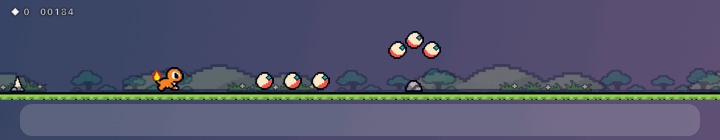
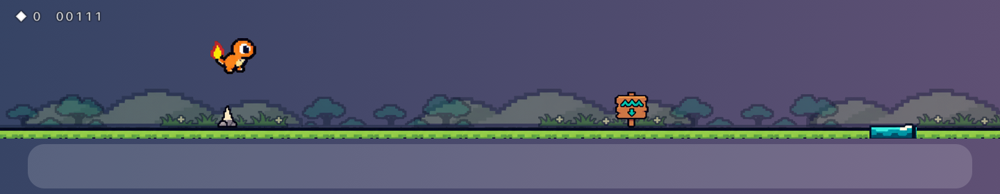
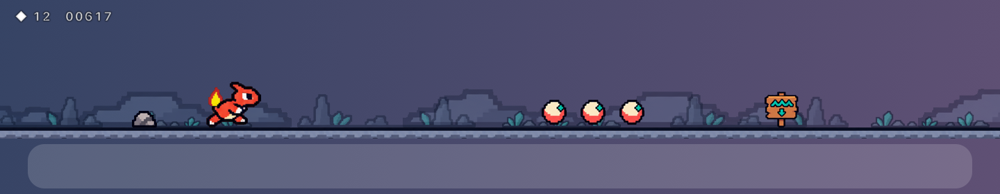
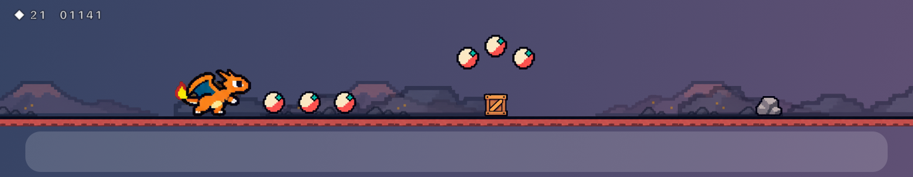
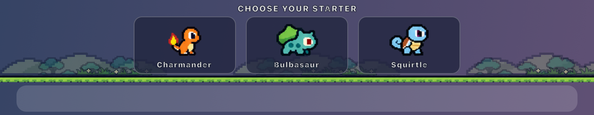
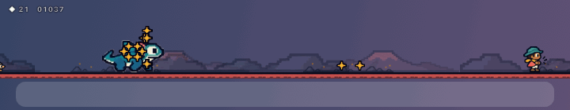

# Embertrail

A tiny endless runner that lives in a see-through strip just above your macOS Dock. Pick your starter (Charmander, Bulbasaur or Squirtle) and run across meadows, crystal caves and volcanoes. Jump rocks and spikes, clear water pits, collect orbs, dodge Team Rocket’s capture orbs, knock out its grunts, and watch your starter evolve twice along the way.



| Meadow | Crystal cave | Volcano |
|---|---|---|
|  |  |  |

## Choose your starter

Three Pokémon starters, each with three forms:

- **Charmander → Charmeleon → Charizard** (fire)
- **Bulbasaur → Ivysaur → Venusaur** (grass)
- **Squirtle → Wartortle → Blastoise** (water)

Pick one the first time you play. Switch anytime with **Change starter** on the home screen, or from the menu-bar menu ▸ Starter. Every starter plays by exactly the same rules.



## Play

1. Click **▶ Play** on the strip (or the character icon in the menu bar ▸ **Play**). The strip takes keyboard focus only now, never on its own.
2. **Space** or **↑** to jump (one fixed jump; no hold-to-fly). Clicking the strip while playing also jumps.
3. **Esc** pauses and hands focus back to your other app. **P** pauses or resumes; **Enter** starts or restarts.

- **Hazards:** rocks, spikes, crates, boulders, and later scuttling crabs and burrowing moles.
- **Water pits:** a wave sign warns you first. Water is deadly for every form.
- **Orbs:** worth 10 points each. When they hang in an arc, the arc shows a safe jump.
- **Score:** distance (1 point per 8 px) plus orbs. Your best score is saved.
- **Evolution:** at 30 s of running your starter takes its second form and the world turns into a crystal cave; at 75 s it takes its final form in a volcanic field. It always waits for safe ground first.
- **Grunt ambush:** Jessie or James throws small capture orbs. They land and roll at you, so jump them, because if one touches you, you're captured: the orb snaps shut and wobbles, and it's game over. Then jump right over the grunt to knock it out cold (swirly eyes, +25).

  
- **Balloon gang:** after 20 s Team Rocket’s Meowth balloon may drift in. It marks a spot on the ground, then drops one rock there, always well ahead of you. If there's no fair spot, it just leaves.

When you're not playing, only the Play button is clickable. Hover anywhere else on the strip and it fades away, with clicks going straight through to your windows, and the game pauses on its own when you switch apps, lock the screen or sleep.

From the menu-bar menu you can also choose the display (with several screens), the width (Narrow, Medium or Wide), the position (raise or lower), and the scenery (Full, Light or Off). You can turn on Reduce Motion, or hide the strip.

## Build

```sh
./build.sh            # builds build/Embertrail.app and runs the self-test
./build.sh --install  # also copies it to /Applications
open /Applications/Embertrail.app
```

Needs macOS 14+ and the Xcode Command Line Tools.

Development tools (the bot plays, frames are rendered exactly like the app):

```sh
build/Embertrail.app/Contents/MacOS/Embertrail --selftest
build/Embertrail.app/Contents/MacOS/Embertrail --snapshot out.png --seconds 50
build/Embertrail.app/Contents/MacOS/Embertrail --record out.gif --from 19.5 --to 34 --fps 12
```

## What's built and what isn't (yet)

**Built and tested** (`--selftest`):
- **Physics:** fixed 1/120 s steps, 19.36 px jump apex, 0.44 s airtime, a 100 ms jump buffer, 70 ms coyote time and a constant 10×14 hitbox for every form.
- **Water:** real gaps in the ground, deadly by drowning.
- **Fair hazards:** every hazard leaves at least a 120 ms jump window at the current speed (zero violations over 30 bot-minutes).
- **Order of checks:** lethal collisions are resolved before orbs are collected, and orbs count once.
- **Evolution:** exactly once per stage, in order, on the ground.
- **Balloon drops:** at least 1.6 s of lead, one authoritative rock, and a 20 s cooldown.
- **Pause and stalls:** pausing adds no score; long stalls pause instead of catching up.
- **Restart:** resets the run and keeps the best score.

**Not done yet:**
- **Native-size art:** sprites are scaled from the generated sheets, not hand-cleaned at 16 to 24 px.
- **Bitmap font:** the HUD uses the system font for now.
- **Sound:** the game is silent.
- **Dock placement:** auto-hidden and side Docks use a bottom-edge fallback (labelled in the Position menu); there's no exact Dock tracking.
- **Real-machine checks:** multiple monitors and 120 Hz displays haven't been tested on hardware.

## Art and licence

This is an unofficial Pokémon fan project, not affiliated with or endorsed by Nintendo, Game Freak, Creatures, or The Pokémon Company. The Pokémon and Team Rocket sprite sheets were supplied by the user; the scenery and other assets come from the original Embertrail art set. See [docs/PROVENANCE.md](docs/PROVENANCE.md). No licence has been chosen for the code; no redistribution licence was supplied with the Pokémon artwork.
